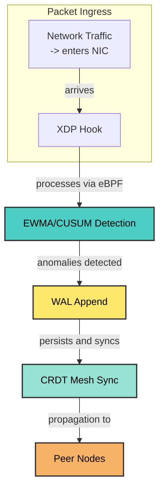

# Architecture Breakdown

## System Flow

## Component Details

| Component | Description | Technology |
|-----------|-------------|------------|
| **Packet Ingress** | Network traffic entering the system | NIC, drivers |
| **XDP Hook** | Kernel eBPF filter for packet inspection | eBPF/XDP |
| **EWMA/CUSUM Detection** | Real-time anomaly detection algorithms | Rate limiting, statistical analysis |
| **WAL Append** | Write-ahead log for persistence | File system |
| **CRDT Mesh Sync** | Conflict-free replication for distributed nodes | CRDT algorithms |
| **Peer Nodes** | Mesh network members | TCP/IP, networking |

## Key Features Demonstrated

1. **Zero-Trust Architecture**: Each component operates independently
2. **Real-Time Detection**: EWMA/CUSUM algorithms for streaming analysis
3. **Fault Tolerance**: Mesh network with CRDT synchronization
4. **Kernel-Bypass**: XDP for high-performance packet filtering
5. **Persistent Storage**: WAL for recovery and audit trails

## Integration Points

- **Detection Layer**: Monitors all incoming traffic patterns
- **Enforcement Layer**: Applies blocks based on detection results
- **Storage Layer**: Maintains state and history
- **Network Layer**: Facilitates peer-to-peer communication